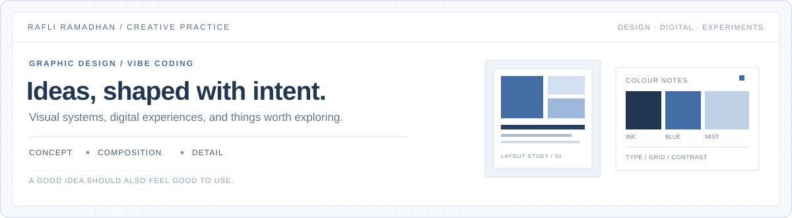
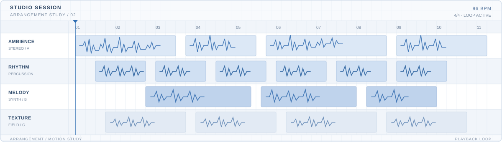
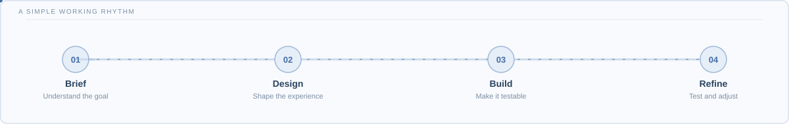
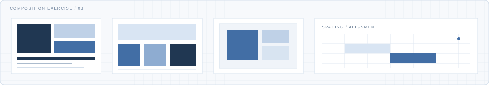
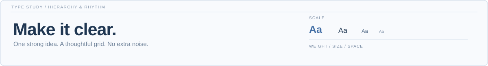
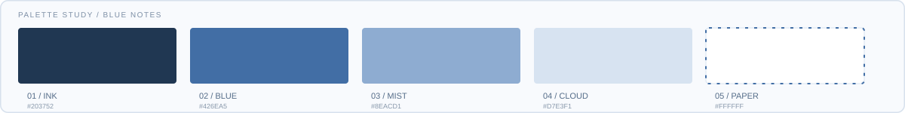

[Portfolio](https://mrr.my.id) &nbsp;·&nbsp; [GitHub projects](https://github.com/Rafli161102?tab=repositories) &nbsp;·&nbsp; [LinkedIn](https://www.linkedin.com/in/m-rafli-r/)

---

<h2> About</h2>

I'm Rafli — a **graphic designer and creative strategist** interested in visual identity, print design, digital experiences, and creative communities.

I also use **vibe coding** as a way to explore web ideas. AI tools help me turn concepts into prototypes; I bring the brief, visual direction, user-flow decisions, testing, and refinement. I'm not claiming to be a traditional software engineer. I learn by making things, checking how they work, and improving the result.

My approach is simple: make the idea clear, take care of the details, and keep the design useful.

<h2> Areas of Practice</h2>

**Graphic design and visual identity**  
Brand marks, campaign materials, layout systems, typography, and visual consistency.

**Print production**  
Pre-press preparation, CMYK checks, 300 DPI artwork, packaging, commercial signage, and print quality control.

**Digital exploration**  
UI/UX ideas, web prototypes, project planning, and AI-assisted product experiments.

<h2> Selected Projects</h2>

### [WibuScript](https://github.com/Rafli161102/wibuscript)

A playful programming-language experiment exploring syntax, a TypeScript-based interpreter, and developer tooling. I approach it as a space to explore ideas and learn through iteration.

### [Seira](https://github.com/Rafli161102/seira)

An early-stage language-design project exploring predictable behavior, explicit effects, and compiler foundations.

### [AquaNime Web](https://github.com/Rafli161102/AquaNime-Web)

A web project connected to AquaNime, the creative community and digital ecosystem I'm building.

### [Community Forge](https://github.com/Rafli161102/community-forge)

A product experiment around tools and workflows for organizing community activity.

<h2> Creative Toolkit</h2>

  

Tools I use or explore across projects, not a claim of expert-level coding in every technology.

<h2> 01 — Studio Session</h2>

A small motion study inspired by a digital audio workstation: layered tracks, rhythm clips, waveforms, timeline markers, and a slow-moving playback head.

  

<h2> 02 — From Brief to Build</h2>

A quiet loop for my working process: understand the brief, shape the design, make a prototype, then refine what needs attention.

  

<h2> 03 — Composition Study</h2>

Modular layouts, spacing, alignment, and contrast — small explorations of the decisions that make a visual system feel balanced.

  

<h2> 04 — Type in Motion</h2>

A typography specimen about hierarchy, scale, and whitespace. The movement stays subtle so the message remains the focus.

  

<h2> 05 — Blue Notes</h2>

A compact colour study using ink, blue, mist, cloud, and paper tones to keep the visual language consistent across the page.

  

<h2> Let's Connect</h2>

Have a project involving visual identity, print design, a creative community, or an AI-assisted digital prototype? Visit my portfolio to see more of my work.

[**View Portfolio**](https://mrr.my.id)

Made with care. Refined one iteration at a time.

