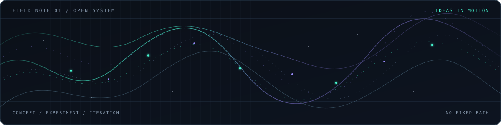

---

<h2> Player Profile</h2>

I'm Rafli — a **creative strategist and graphic designer** who enjoys bringing ideas into visual form and digital experiences.

I call my development workflow **vibe coding**. I use AI tools to help turn a brief into a prototype or web experience, while I focus on the idea, visual direction, user flow, testing, and iteration. I'm not presenting myself as a traditional programmer; I'm learning by building, checking the results, and improving them one pass at a time.

My interests sit between visual design, creative communities, digital products, and experiments that are a little unusual.

<h2> Current Run</h2>

<table>
  <tr>
    <td width="25%" valign="top">
      01 / THINK 
      <strong>Find the idea</strong> 
      <small>Define the goal before opening the tools.</small>
    </td>
    <td width="25%" valign="top">
      02 / SHAPE 
      <strong>Design the feel</strong> 
      <small>Set the visual direction and user flow.</small>
    </td>
    <td width="25%" valign="top">
      03 / BUILD 
      <strong>Work with AI</strong> 
      <small>Turn the concept into something testable.</small>
    </td>
    <td width="25%" valign="top">
      04 / REFINE 
      <strong>Play-test</strong> 
      <small>Spot rough edges, then iterate.</small>
    </td>
  </tr>
</table>

<h2> Quest Log</h2>

<table>
  <tr>
    <td width="50%" valign="top">
      <h3><a href="https://github.com/Rafli161102/wibuscript">WibuScript</a></h3>
      LANGUAGE EXPERIMENT
      
A playful programming-language project exploring syntax, a TypeScript-based interpreter, and developer tooling.

      
    </td>
    <td width="50%" valign="top">
      <h3><a href="https://github.com/Rafli161102/seira">Seira</a></h3>
      LANGUAGE DESIGN
      
An early-stage language experiment focused on predictable behavior, explicit effects, and compiler foundations.

      
    </td>
  </tr>
  <tr>
    <td width="50%" valign="top">
      <h3><a href="https://github.com/Rafli161102/AquaNime-Web">AquaNime Web</a></h3>
      COMMUNITY ECOSYSTEM
      
A web project connected to AquaNime, the creative community and digital ecosystem I'm building.

      
    </td>
    <td width="50%" valign="top">
      <h3><a href="https://github.com/Rafli161102/community-forge">Community Forge</a></h3>
      PRODUCT EXPERIMENT
      
An exploration of digital tools and workflows for organizing community activity.

      
    </td>
  </tr>
</table>

<h2> My Creative Loadout</h2>

<table>
  <tr>
    <td width="33%" valign="top">
      <strong>Visual design</strong> 
      Brand identity, graphic design, marketing materials, and visual systems.
    </td>
    <td width="33%" valign="top">
      <strong>Production details</strong> 
      Print-ready files, CMYK checks, layout consistency, and quality control.
    </td>
    <td width="33%" valign="top">
      <strong>Digital projects</strong> 
      Product direction, UI/UX exploration, planning, and AI-assisted web prototypes.
    </td>
  </tr>
</table>

  
  
Tools and technologies encountered across my projects. The icons are a toolbox, not a claim of expert-level coding in every item.

<h2> Signal Field</h2>

A small visual for how I like to work: loose ideas travelling through experiments, taking shape, then changing direction when something better appears. No leaderboard, no contribution snake — just motion.

  

<h2> Continue Exploring</h2>

Have an idea for a visual identity, community project, digital experience, or AI-assisted prototype? Take a look at my work or reach out through my portfolio.

  

  RFLI.EXE / SAVE OFTEN / STAY CURIOUS / KEEP BUILDING

