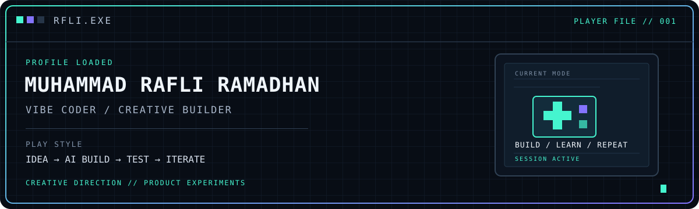

---

<h2> PLAYER MENU</h2>

<table>
  <tr>
    <td width="34%" valign="top">
      <strong>PLAYER</strong> 
      Rafli / Indonesia
    </td>
    <td width="33%" valign="top">
      <strong>CLASS</strong> 
      Vibe Coder
    </td>
    <td width="33%" valign="top">
      <strong>BUILD</strong> 
      Creative Products
    </td>
  </tr>
</table>

I'm a **vibe coder**: I use AI-assisted coding tools to turn ideas into prototypes, websites, and digital product experiments. I'm not presenting myself as a traditional software engineer. My role is to shape the idea, define the experience, guide the visual direction, test what gets built, and keep iterating.

I come from the creative and product side of technology, with interests spanning digital communities, project coordination, UI/UX, and AI-assisted building. I'm learning the technical foundations while making things that people can actually explore and use.

<h2> QUEST LOG</h2>

<table>
  <tr>
    <td width="50%" valign="top">
      <h3><a href="https://github.com/Rafli161102/wibuscript">01 / WibuScript</a></h3>
      
      
Exploring what a programming language can look and feel like, including a TypeScript-based interpreter and language tooling.

      STATUS: EXPERIMENTING
    </td>
    <td width="50%" valign="top">
      <h3><a href="https://github.com/Rafli161102/seira">02 / Seira</a></h3>
      
      
An early-stage programming language experiment exploring explicit effects, predictable semantics, and compiler foundations.

      STATUS: SEED STAGE
    </td>
  </tr>
  <tr>
    <td width="50%" valign="top">
      <h3><a href="https://github.com/Rafli161102/AquaNime-Web">03 / AquaNime Web</a></h3>
      
      
Building the web presence for a community and creative ecosystem, combining content, identity, and digital experiences.

      STATUS: ITERATIVE BUILD
    </td>
    <td width="50%" valign="top">
      <h3><a href="https://github.com/Rafli161102/community-forge">04 / Community Forge</a></h3>
      
      
A product experiment around making community operations and management workflows easier to organize.

      STATUS: PRODUCT EXPLORATION
    </td>
  </tr>
</table>

<h2> WORLD MAP / CREATIVE WORK</h2>

<table>
  <tr>
    <td width="33%" valign="top">
      
      <h3><a href="https://aquanime.id">AquaNime</a></h3>
      FOUNDER &amp; CEO
      
Creative hub, community, and digital ecosystem projects.

    </td>
    <td width="33%" valign="top">
      
      <h3><a href="https://xirestudios.com">XireStudios</a></h3>
      CHIEF MARKETING OFFICER
      
Creative work, communication, and brand direction.

    </td>
    <td width="33%" valign="top">
      
      <h3>ToM Project</h3>
      PROJECT MANAGER
      
Helping coordinate a creative project in development.

    </td>
  </tr>
</table>

<h2> INVENTORY</h2>

Tools are part of my build process rather than a claim of expert-level coding. I use them to explore ideas, communicate direction, prototype, and refine results.

  

  
<strong>Open inventory details</strong>

   
  <table>
    <tr><td><strong>Creative direction</strong></td><td>Visual references, layout decisions, design feedback</td></tr>
    <tr><td><strong>AI-assisted building</strong></td><td>Turning briefs and prompts into working prototypes</td></tr>
    <tr><td><strong>Product iteration</strong></td><td>Trying flows, checking results, finding rough edges, refining</td></tr>
    <tr><td><strong>Community and project work</strong></td><td>Coordination, brand direction, digital experiences</td></tr>
    <tr><td><strong>Learning path</strong></td><td>Understanding the technical foundations behind the tools I use</td></tr>
  </table>

<h2> ACHIEVEMENT BOARD</h2>

<table>
  <tr>
    <td valign="top" width="50%">
      <strong>CREATOR</strong> 
      Starting and shaping creative community projects.
    </td>
    <td valign="top" width="50%">
      <strong>EXPERIMENTER</strong> 
      Exploring programming-language concepts through WibuScript and Seira.
    </td>
  </tr>
  <tr>
    <td valign="top" width="50%">
      <strong>PRODUCT THINKER</strong> 
      Connecting ideas, interface decisions, and user-facing outcomes.
    </td>
    <td valign="top" width="50%">
      <strong>WORK IN PROGRESS</strong> 
      Learning by building, testing, and improving each iteration.
    </td>
  </tr>
</table>

<h2> ACTIVITY MAP</h2>

  

<h2> NEXT PLAYER?</h2>

Interested in creative technology, AI-assisted products, digital communities, or unusual software experiments? Explore the projects above or connect with me.

  
  

  RFLI.EXE // SAVE OFTEN. STAY CURIOUS. KEEP BUILDING.

